# Qook launch-readiness audit

**Audit date:** July 26, 2026  
**Branch audited:** `phase3a-wiring` at `d5e82ee`  
**Scope:** product and UX, Expo client, Supabase functions, auth/account deletion, accessibility, automated checks, release configuration, App Store compliance, ASO, and initial acquisition strategy.

## Executive verdict

Qook is a strong **internal TestFlight product** with a differentiated brand and a coherent dinner-to-plan-to-shop loop. It is not yet a safe public App Store or paid-acquisition build.

The gap is not another redesign. It is one focused hardening sprint followed by an external TestFlight cohort:

| Area | Assessment | Why |
| --- | --- | --- |
| Brand and visual system | Strong | Distinct watercolor food art, restrained chrome, memorable typography and palette |
| Core product loop | Strong | Energy → small hand of ideas → plan → grocery list is clear and useful |
| Feature honesty | At risk | Several settings are currently local-only and do not affect generation or layout |
| Engineering baseline | Good | Typecheck, lint, client tests, and Edge Function type checks pass |
| Cost and abuse controls | Not launch-ready | Temporary generation quotas remain effectively disabled; paid endpoints lack ownership checks |
| App Store compliance | Not launch-ready | Legal URLs are disabled/stale, App Privacy work is incomplete, and Sign in with Apple deletion/revocation needs hardening |
| Accessibility | Not launch-ready | primary actions and the context screen were missing from the runtime accessibility snapshot |
| Growth readiness | Premature | No product analytics or crash reporting means paid acquisition cannot be evaluated beyond installs |

My launch recommendation:

1. Keep internal dogfooding now.
2. Fix the P0 items below before opening an external TestFlight.
3. Run a small external beta and a fresh production archive from the release commit.
4. Submit to App Review.
5. Start paid acquisition only after activation, generation reliability, retention, and cost are measurable.

## What is already working

- The product has a real point of view. “Dinner matched to the energy you have” is more ownable than a generic AI meal planner.
- Tonight, Plan, Shop, Saved, recipe detail, settings, Apple sign-in entry, and account deletion entry points are implemented.
- The weekly reset deck and progressive re-deal design are substantially present.
- Recipe detail is polished enough to be an App Store screenshot.
- The Plan → Shop relationship is immediately understandable.
- The app has a valid production EAS history, a configured bundle ID (`com.kata.qook`), working icon/splash assets, and live Supabase mode.
- Automated client coverage is meaningful: 107 Bun tests passed.
- Edge Function modules type-check successfully.

## P0 — fix before external TestFlight

### 1. Make personalization real, or remove the claims

The settings UI says preferences shape generation, serving count scales recipes, and avoided ingredients are a “Hard filter.” In the current client, these values live only in the persisted Zustand store. No native code writes them to the server-side `user_preferences` table that generation reads.

The same audit found `defaultTier`, `planningStartDay`, `unitSystem`, and `partnerName` consumed only by their settings/summary screens. They do not currently change the energy flow, week layout, recipe measurements, or generation.

This is the most important product-trust bug:

- An avoided allergen can still be suggested.
- A selected household size does not reach server generation.
- Cuisine/protein choices do not tune server generation.
- Several visible controls are effectively decorative.

**Required:** define one preferences contract, sync it to Supabase, verify RLS, and add an integration test proving that household size and an avoided ingredient reach the prompt. Until that is complete, change the allergy copy to a non-safety claim and do not market allergy-safe personalization.

Evidence:

- `apps/native/src/stores/prefs.ts`
- `apps/native/src/features/more/PreferencesScreen.tsx`
- `supabase/functions/_shared/context.ts`
- `supabase/functions/generate-proposals/index.ts`

### 2. Restore quotas and secure paid AI work

`DAILY_MAX` and `MONTHLY_MAX` are still set to `1000` and `5000`, alongside a source comment to restore `10 / 30` before TestFlight. The corresponding Edge Function tests fail because they still expect the intended launch limits.

`generate-image` and `fill-recipe` authenticate the caller but do not verify that the requested recipe belongs to a generation session accessible to that user. Both functions use the service role after accepting a recipe UUID. The image lock prevents concurrent duplicate spend, but failed images remain retryable; fill requests can also be triggered for another user’s globally readable proposal skeleton.

**Required:**

- Restore and centralize launch quotas.
- Add a per-user and global cost ceiling.
- Require a valid generation-session/item relationship before filling or painting a proposal.
- Cap paid retries and record retry counts.
- Alert on daily spend, error rate, and p95 generation latency.
- Make the quota tests green before deployment.

Evidence:

- `supabase/functions/_shared/rate-limit.ts`
- `supabase/functions/generate-image/index.ts`
- `supabase/functions/fill-recipe/index.ts`

### 3. Finish the legal and privacy surface

Privacy Policy, Terms of Service, and feedback are disabled in More. The bundled policy is from March 2026 and describes voice recordings, Whisper, and Convex, while the active product uses typed context, Supabase, OpenRouter/Anthropic, and Gemini image generation.

Apple requires a privacy-policy URL in App Store Connect and an accessible policy inside the app. App Privacy disclosures must cover data collected by the app and its third-party partners. See Apple’s [App Review Guidelines](https://developer.apple.com/app-store/review/guidelines/), [App Privacy management reference](https://developer.apple.com/help/app-store-connect/manage-app-information/manage-app-privacy/), and [App Privacy details](https://developer.apple.com/app-store/app-privacy-details/).

**Required:**

- Provision `qook.app`, `qook.app/privacy`, `qook.app/terms`, and a real support URL.
- Rewrite the policy around the actual data flow and processors.
- State retention/deletion behavior for generation sessions and free-form context.
- Complete App Privacy labels from an explicit data inventory.
- Verify whether required-reason API declarations are needed and add the Expo `ios.privacyManifests` configuration where applicable. Apple and Expo document this in [Adding a privacy manifest](https://developer.apple.com/documentation/bundleresources/adding-a-privacy-manifest-to-your-app-or-third-party-sdk) and [Expo’s privacy manifest guide](https://docs.expo.dev/guides/apple-privacy/).
- Enable the in-app legal rows.

### 4. Complete Sign in with Apple deletion and device verification

Account deletion exists and deletes the Supabase user with cascading data cleanup. That is a good baseline. The current flow does not retain the Apple authorization code/refresh token or revoke the Sign in with Apple token before deleting the account. The sign-in request also does not use a nonce.

Apple explicitly calls out token revocation for apps using Sign in with Apple, including accounts created automatically for guests. See [Offering account deletion in your app](https://developer.apple.com/support/offering-account-deletion-in-your-app/) and [TN3194](https://developer.apple.com/documentation/technotes/tn3194-handling-account-deletions-and-revoking-tokens-for-sign-in-with-apple).

**Required:**

- Add nonce handling.
- Implement the server-side token-revocation path and store only the minimum credential material necessary.
- Verify anonymous → Apple upgrade, returning Apple login, session restoration, sign-out, and deletion on a signed-in physical device.
- Confirm that deletion removes user rows and invalidates the session while preserving only intentional global cache content.

### 5. Repair the accessibility tree

The runtime accessibility snapshot did not expose:

- the primary “Find tonight’s dinner” CTA,
- the energy screen’s “See dinner ideas” CTA, or
- any controls on the context step, including its text field, suggestion chips, close control, skip control, and primary CTA.

`PolishedButton` does not set a button role or default accessibility label. `ContextStep` wraps the full screen in `TouchableWithoutFeedback`, which is the leading suspect for hiding its descendants from the runtime accessibility tree.

**Required:**

- Give `PolishedButton` `accessibilityRole="button"` and a label derived from `label`.
- Remove or neutralize the full-screen accessible touch wrapper.
- Label the context input and suggestion chips.
- Test with VoiceOver, large accessibility text sizes, Reduce Motion, and increased contrast on a physical device.

This audit used the runtime accessibility snapshot as evidence; it was not a complete assistive-technology certification.

## P1 — fix before App Review

### Release integrity

- The most recent successful production EAS archive found was build 4 from July 12, 2026.
- The audited HEAD is 66 commits ahead of that archive.
- Run a new production archive from the exact release commit and perform a clean-install TestFlight regression.
- `expo-doctor` passed 16 of 18 checks. It reported four slightly stale Expo packages and duplicate `expo` / `expo-constants` native installations caused by the Bun dependency layout. Resolve both before the next archive.
- Decide whether the public release should present as `1.0.0` instead of `0.1.0`.
- Add CI for typecheck, lint, Bun tests, Deno checks/tests, and an Expo configuration check.

### Data contracts and dead paths

`apps/native/src/services/api.ts` still contains raw casts from Supabase rows to domain types in older plan, deck, swipe-feed, and grocery bindings. These bypass the mapper used by `getRecipeById`.

Delete truly dead endpoints or map and test every live row shape. Do not leave an apparently callable live API with snake_case/domain-shape mismatches.

### Reliability and feedback

- Add crash/error reporting.
- Add privacy-safe product events for onboarding completion, generation start/success/failure, first keep, week planned, Shop opened, recipe opened, and cooking started/completed.
- Do not attach free-form meal context to analytics events.
- Measure actual generation latency before promising “about 15 seconds.”
- Add a working feedback route before the external beta.
- Test offline launch, network loss during generation, app background/resume, slow image completion, and retry behavior.

### Food and recipe trust

The active prompt modules do not contain an explicit food-safety rubric for doneness or internal temperatures. Add deterministic prompt rules and a test corpus for raw poultry, ground meat, leftovers, allergen exclusions, and cross-contamination language. AI-generated recipes should not be marketed as allergy-safe without a stronger validation layer.

### Cross-device expectations

The weekly plan, saved state, cooking progress, and user preferences are primarily local. Sign in with Apple therefore does not currently provide the cross-device account value many users will assume.

Either:

- sync the user-visible state, or
- clearly position v1 as private, device-local planning and avoid account-sync claims.

## Fresh flow review

All screens below were captured from the running iPhone 17 Simulator during this audit.

### 1. Recipe detail

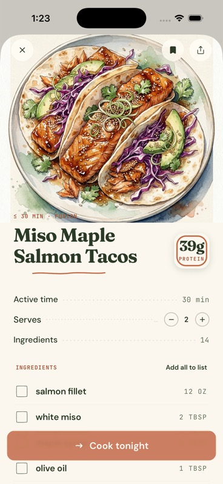

**Healthy:** distinctive art, strong hierarchy, scannable ingredient grouping, and a clear sticky cooking action.  
**Improve:** verify generated-food safety, long-title wrapping, large text, and the full cooking workflow on device.

### 2. Tonight empty state

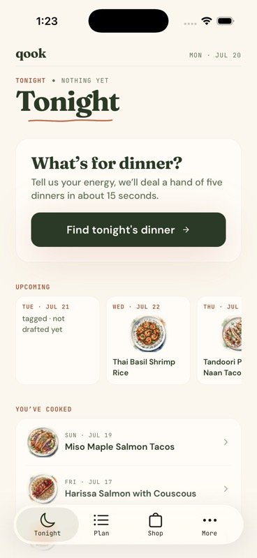

**Healthy:** immediate value proposition and a calm first action.  
**Improve:** the CTA was missing from the accessibility snapshot; replace the unverified “about 15 seconds” promise if measured p95 is slower.

### 3. Weekly plan

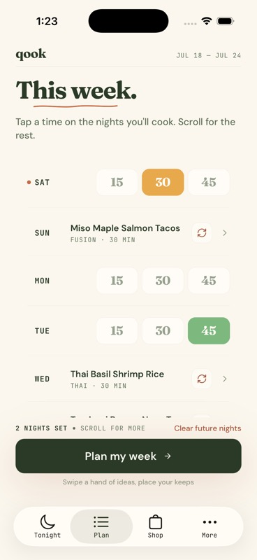

**Healthy:** seven-day energy overview, recipe allocation, and “Plan my week” are understandable at a glance.  
**Improve:** make the Sunday/Monday setting actually change the layout before exposing it.

### 4. Grocery list

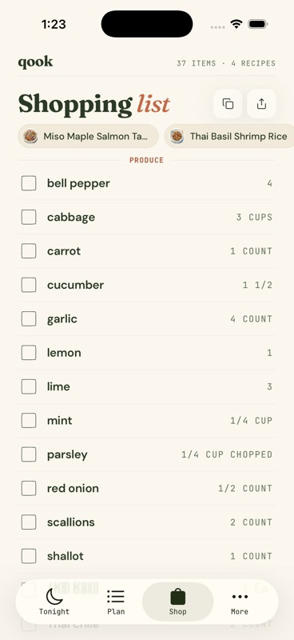

**Healthy:** meal filters, grouped ingredients, count summary, copy, and share make this feel complete.  
**Improve:** test very large lists, duplicate aggregation, unit conversion, and grocery edits.

### 5. Settings overview

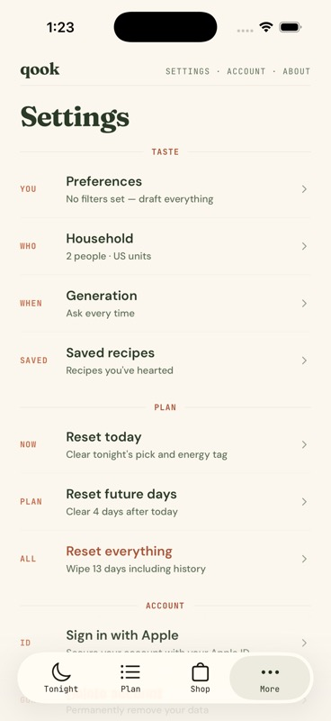

**Healthy:** clear information architecture and current-state summaries.  
**Improve:** visible settings must affect product behavior; reduce the unused space after the final group.

### 6. Account and legal

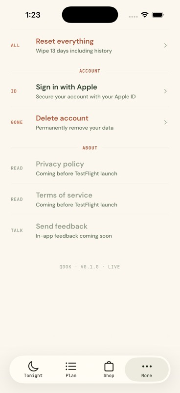

**Healthy:** sign-in and deletion are easy to locate.  
**Blocked:** legal and feedback rows are disabled.

### 7. Apple authentication attempt

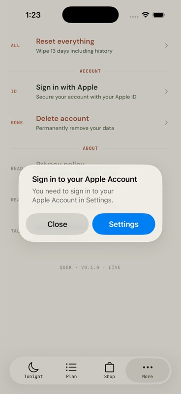

**Result:** the native Apple flow opened correctly, but the Simulator had no Apple Account configured. This is a verification limitation, not proof of an app defect. Successful authentication still needs a physical-device TestFlight pass.

### 8. Account deletion confirmation

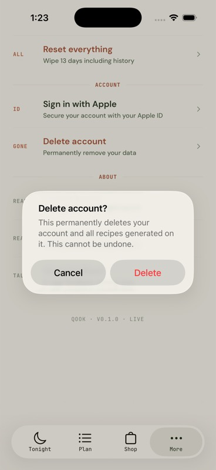

**Healthy:** the destructive action is explicit and cancelable.  
**Not executed:** the final destructive confirmation was intentionally not pressed.

### 9. Saved recipes

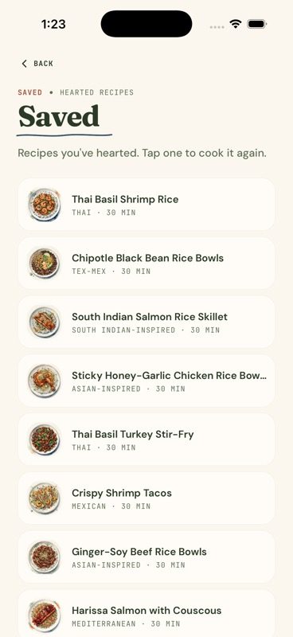

**Healthy:** the destination exists and reuses the visual system well.  
**Improve:** one long recipe title visibly truncates; verify its full accessible name and detail navigation.

### 10. Energy picker

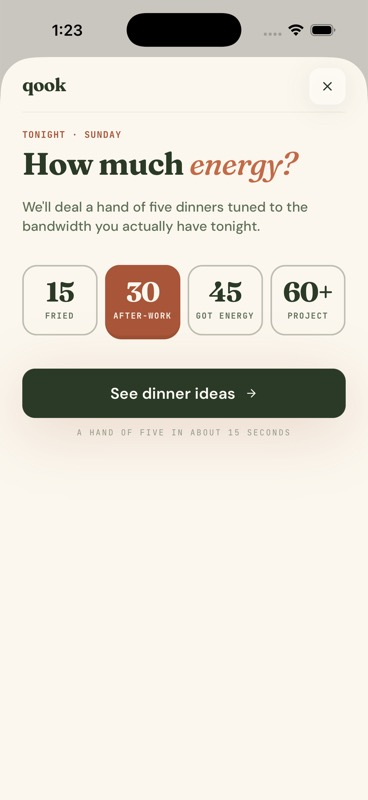

**Healthy:** this is Qook’s most differentiating interaction and should lead App Store creative.  
**Improve:** the primary CTA was absent from the accessibility snapshot.

### 11. Optional context

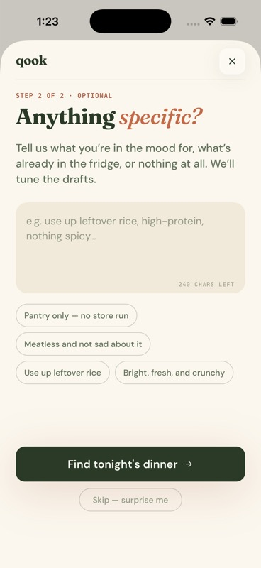

**Healthy:** excellent examples and a low-pressure skip path.  
**Blocked:** the entire screen’s controls were absent from the runtime accessibility snapshot.

## Verification results

| Check | Result |
| --- | --- |
| `bun run typecheck` | Pass |
| `bun run lint` | Pass |
| Bun test suite | 107 passed, 0 failed |
| Deno check of six Edge Function entry points | Pass |
| Deno unit tests | 53 passed, 2 failed |
| Deno failures | Both quota assertions: source is 1000/day and 5000/month; tests expect 10/day and 30/month |
| `expo-doctor` | 16/18 checks passed |
| Current-head production archive | Not verified |
| Successful Apple login | Not verified; Simulator account unavailable |
| Destructive account deletion | Not executed |
| Live paid generation | Not executed to avoid unnecessary external API cost |
| Live Supabase deployment parity | Not verified; local Supabase CLI failed while listing remote functions |

## App Store packaging and ASO

Apple currently permits an app name and subtitle of up to 30 characters, a 100-byte keyword field, promotional text up to 170 characters, and a description up to 4,000 characters. See [App information](https://developer.apple.com/help/app-store-connect/reference/app-information/app-information) and [platform version information](https://developer.apple.com/help/app-store-connect/reference/app-information/platform-version-information).

### Recommended metadata

**Name:** `Qook: Dinner Planner`  
**Subtitle:** `Tonight’s dinner, sorted.`  
**Primary category:** Food & Drink  
**Secondary category:** Lifestyle  
**Keyword field (98 bytes):**

`meal,grocery,list,recipes,weeknight,cooking,weekly,menu,shopping,easy,prep,family,quick,ideas,food`

The name carries the high-intent “dinner planner” terms. The subtitle preserves the brand promise. The keyword field does not waste bytes repeating the name.

Suggested opening:

> Qook helps you answer one question: what’s for dinner tonight? Tell it how much energy you have, swipe a small hand of ideas, and turn your picks into a weekly plan and grocery list.

Do not lead with “AI.” The user benefit is relief from dinner decision fatigue, not the model.

### Screenshot narrative

Apple supports 1–10 screenshots and recommends uploading the highest-resolution required size. See [Uploading previews and screenshots](https://developer.apple.com/help/app-store-connect/manage-app-information/upload-app-previews-and-screenshots) and [screenshot specifications](https://developer.apple.com/help/app-store-connect/reference/app-information/screenshot-specifications/).

Recommended first five:

1. **Dinner matched to the energy you have** — Energy picker
2. **Swipe a small hand. Keep what sounds good.** — Review/deck
3. **Plan the week without overplanning** — Plan
4. **Your grocery list writes itself** — Shop
5. **Cook from a recipe you’ll actually make** — Recipe detail

Do not feature the preferences screen until the controls affect generation.

### Competitive position

Current App Store products such as [Eatpace](https://apps.apple.com/us/app/eatpace-dinner-meal-planner/id6760430125), [MealMap](https://apps.apple.com/us/app/mealmap-ai-meal-planner/id6761233196), and [Saffie](https://apps.apple.com/us/app/saffie-ai-meal-planner/id6745905690) already occupy “AI meal planner” and “stop deciding what to cook” language.

Qook should own:

> **Dinner ideas matched to the energy you actually have tonight.**

That positioning connects the differentiating control, the moment of need, and the emotional job.

## Acquisition plan

### Before spending

Define activation as:

> A new user keeps or selects a dinner and then opens Shop or starts cooking in the first session.

Track:

- onboarding completion,
- generation success and latency,
- proposal keep rate,
- activation,
- week-one repeat generation,
- week planning completion,
- Shop usage,
- Day-1 and Day-7 retention,
- estimated AI cost per activated user.

There is no v1 monetization, so paid ads cannot yet be judged against real customer lifetime value. Use acquisition as a learning budget, not a scaling channel.

### Launch sequence

1. **Internal TestFlight:** dogfood the P0 fixes and verify cost controls.
2. **External TestFlight:** 50–100 target users; collect structured feedback and retention.
3. **Organic launch:** short “Tuesday at 6 p.m.” demos showing Energy → hand → Shop; launch `qook.app`; collect email and support requests.
4. **App Store release:** ship only after a clean physical-device matrix and legal review.
5. **Small Apple Ads test:** separate exact-intent, discovery/Search Match, category, and competitor ad groups. Use negative keywords and measure activated users, not installs. Apple’s current guidance is in [Keyword best practices](https://ads.apple.com/app-store/best-practices/keywords) and [Add and manage keywords](https://ads.apple.com/app-store/help/keywords/0014-add-and-manage-keywords).
6. **Optimize creative:** test the first screenshot and value proposition with [Product Page Optimization](https://developer.apple.com/help/app-store-connect-analytics/acquisition/product-page-optimization/). Later, use [custom product pages](https://developer.apple.com/help/app-store-connect/create-custom-product-pages/configure-multiple-product-page-versions/) for “quick weeknight dinners,” “weekly planning,” and “grocery list” campaigns.

## Release gate

Qook is ready to submit when all of the following are true:

- Preferences reliably reach generation and the hard-exclusion test passes.
- Launch quotas, ownership checks, retry limits, and cost alerts are deployed.
- Privacy, Terms, Support, and feedback links work in the app and App Store Connect.
- App Privacy labels and any required privacy manifest declarations are complete.
- Apple sign-in upgrade/login/revocation/deletion pass on a physical device.
- The accessibility tree contains every primary action and the context flow.
- Expo Doctor is green or every exception is documented and proven safe.
- A current production EAS archive passes the device regression matrix.
- Generation success rate, p95 latency, activation, and cost per activation are measurable.
- Store copy and screenshots make no unsupported personalization, allergy, timing, or sync claims.

